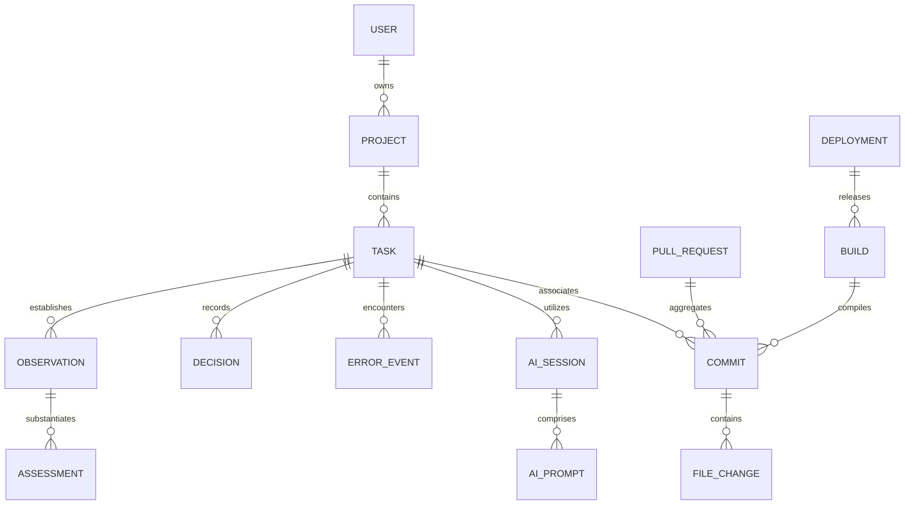
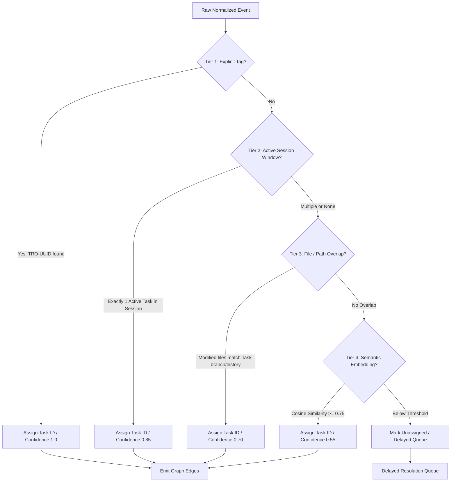
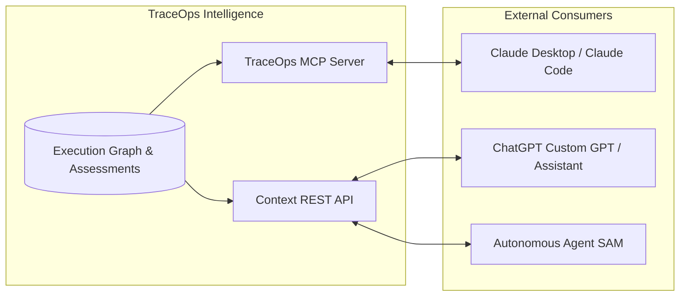
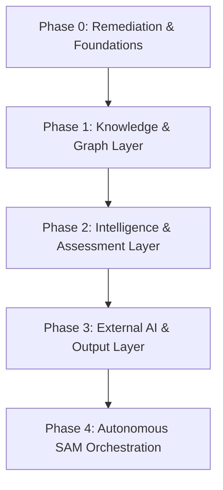

# TraceOps Product Requirements and Architecture Specification (PRD & System Spec)

**Document Version:** 1.0.0  
**Status:** Approved Architectural Baseline  
**Scope:** Core Architecture, Domain Ontology, Execution Graph, Observation Engine, Assessment Engine, AI Context Interface, and Current Codebase Remediation  

---

## 1. Executive Summary & Ideology

### 1.1 Vision & Core Identity
**TraceOps is an Evidence-Driven Engineering Execution Intelligence platform.**

TraceOps is **not** an AI coding assistant (like ChatGPT, Claude, Cursor, or Copilot), nor is it a passive developer time/activity tracker. It does not generate code for the developer, nor does it merely record raw keystrokes or endpoint pings.

TraceOps exists to answer ten fundamental questions about software engineering execution:
1. *What did I actually do?*
2. *What did I build?*
3. *How did I build it?*
4. *How much real progress was achieved?*
5. *What worked and what failed?*
6. *Where was effort wasted or stalled?*
7. *What bottlenecks are degrading execution velocity?*
8. *What execution patterns should be improved?*
9. *What achievements can be independently substantiated with verifiable evidence?*
10. *What high-impact objective should be tackled next?*

### 1.2 The Core Problem
Modern software development is fragmented across GitHub, IDEs, terminal sessions, AI proxies, deployment clouds, and project tracking systems. No single system preserves a unified, evidence-backed narrative of execution. 

Consequently:
- Developers manually explain their work to AI models without objective context.
- LLMs evaluate progress based on self-reported, incomplete, or hallucinated claims.
- Real achievements, technical debt, rework loops, and systematic bottlenecks vanish.
- Resumes, LinkedIn posts, and engineering audits rely on unverified claims rather than verifiable engineering artifacts.

TraceOps captures raw development telemetry, correlates it into a coherent **Execution Graph**, calculates deterministic **Observations**, produces versioned **Assessments**, and surfaces a structured **External AI Context Interface** for humans and autonomous agents (such as SAM, Claude, and ChatGPT).

### 1.3 The 10 Inviolable Architectural Principles

| # | Principle | Operational Meaning |
|---|---|---|
| **1** | **Evidence Before Claims** | No metric, score, or audit summary may exist without cryptographic or relational links to underlying evidence. |
| **2** | **Reality Before Reporting** | Telemetry must reflect actual system state (commits, diffs, deploys, logs), not self-reported estimates. |
| **3** | **Observations Before Interpretation** | What happened (facts) must be strictly isolated from what it means (evaluation/opinions). |
| **4** | **Domain Knowledge Before LLM Reasoning** | Engineering data must be modeled into formal ontological entities before being ingested by AI models. |
| **5** | **Provenance and Traceability** | Every assertion must trace back to its origin (author, tool, raw payload hash, timestamp, repository). |
| **6** | **Honest Uncertainty** | Gaps in telemetry must be explicitly measured as low confidence, never fabricated as successful execution. |
| **7** | **Historical Continuity** | Progress is an integrated trajectory over time, preserved across days, weeks, and quarters. |
| **8** | **Strict User Ownership & Tenant Isolation** | Every entity belongs to a single authenticated tenant; cross-tenant data leakage is structurally impossible. |
| **9** | **Model Independence** | External LLMs are interchangeable consumers of structured TraceOps context; the platform never binds to a single AI provider. |
| **10** | **Actionable Intelligence** | Intelligence must drive concrete interventions (rework reduction, loop prevention, unblocking stalled tasks). |

---

## 2. Current System Audit & Codebase Mapping

An exhaustive audit of the existing repository source code reveals a strong backend starting skeleton, but with notable security vulnerabilities, API breaks, and architectural gaps where core intelligence systems should be.

### 2.1 Repository Component Status Matrix

| Module / File | Current Status | Detailed Audit Assessment & Required Action |
|---|---|---|
| `app/models/models.py` | **Partial / Requiring Repair** | Contains `User`, `UserSession`, `Integration`, `OAuthState`, `Task`, `Event`, `Score`, `Report`, `AIProxyLog`. **Defects:** Lacks Project, Commit, PR, Build, Deployment, Error, and Graph Edge models. `Integration.access_token` stored in plaintext. |
| `app/api/auth/routes.py` | **Implemented** | GitHub/Google OAuth flow, session creation, HTTP-only cookies, state token CSRF validation. |
| `app/api/auth/deps.py` | **Implemented** | `get_current_user` extracts and validates session cookie/bearer token. Functional, but underutilized in data routes. |
| `app/api/tasks.py` | **Requiring Repair** | `POST /task/start` creates tasks with `user_id=None` by default. Does not enforce `get_current_user`. No project relationship. |
| `app/api/events.py` | **Requiring Repair** | Ingests generic events and webhooks without enforcing authentication or tenant validation. Lacks deduplication checks. |
| `app/api/reports.py` | **Requiring Repair** | `_generate_report_for_date` runs `select(Task).where(Task.date == target_date)` across **all tenants**, leaking data across users. |
| `app/api/proxy.py` | **Partial** | Proxies OpenAI/Anthropic calls, logs prompts and tokens. Lacks deterministic session boundary grouping. |
| `app/api/integrations/routes.py` | **Partial / Requiring Repair** | Lists catalog, supports OAuth and manual commit polling. **Defect:** `_sync_github` fetches only 10 commits, lacks cursors, does not deduplicate. |
| `app/api/metrics.py` | **Partial** | Exposes metrics and health. Requires strict API key protection. |
| `app/api/scheduler.py` | **Partial** | In-process background scheduler for daily reports. Needs operational Celery-beat integration. |
| `app/services/scoring.py` | **Implemented (v3)** | Implements active time, continuity ratio, velocity v3, rate-based AI efficiency. **Defect:** Uses heuristic scoring formulas rather than versioned assessment models. |
| `tests/test_scoring.py` | **Broken / Requiring Repair** | **Broken:** Imports obsolete `compute_ai_penalty` and calls legacy v1 `compute_score(level, start, end, ...)` resulting in test collection errors. Must be rewritten. |
| `tests/test_v3.py` | **Implemented** | Validates v3 scoring, continuity ratio, anti-gaming, and config persistence. |
| `app/services/correlator.py` | **Partial** | Basic heuristic scoring (time + task_id + cosine similarity). Does not construct an execution graph. |
| `app/services/task_enforcement.py` | **Implemented (v3)** | Enforces task ID presence with regex `[TRO-...]`, fallback assignment, and replay protection HMAC. |
| `app/services/loop_detection.py` | **Implemented (v3)** | Detects prompt repetition using SentenceTransformers embeddings and cosine similarity. |
| `app/services/llm_analyzer.py` | **Requiring Repair** | Prompts LLM for bottlenecks and root causes. **Defect:** Feeds unstructured strings without verifiable observation IDs; promotes ungrounded hallucinations. |
| `app/services/report_gen.py` | **Partial** | Generates markdown reports. Lacks evidence traceability links and tenant scoping. |
| `app/services/webhook_durability.py` | **Implemented** | Computes SHA256 idempotency key, retries failed deliveries. |
| `app/services/anti_gaming.py` | **Implemented** | Heuristic checks for rapid artificial commits and trivial commit spam. |
| **TraceOps Ontology Layer** | **Missing** | Formal models for `Project`, `Commit`, `Branch`, `PullRequest`, `FileChange`, `Deployment`, `AISession`. |
| **Execution Graph Engine** | **Missing** | Directed graph linking events, tasks, commits, artifacts, and decisions into a coherent DAG. |
| **Observation Engine** | **Missing** | Deterministic pipeline extracting verifiable facts and metrics from the Execution Graph. |
| **Assessment Engine** | **Missing** | Versioned, auditable assessment generator with explicit confidence, coverage limits, and evidence hashes. |
| **Historical Replay Engine** | **Missing** | Temporal traversal and state reconstruction across arbitrary historical windows. |
| **External AI Context Interface** | **Missing** | Model Context Protocol (MCP) server and REST endpoints supplying structured context to ChatGPT/Claude/SAM. |
| **Evidence-Backed Output Engine** | **Missing** | Generator producing defensible LinkedIn posts, resumes, and release notes with citations. |

---

## 3. TraceOps Domain Ontology Specification

The TraceOps Domain Ontology defines the first-class entities of software engineering execution and the permissible directed relationships between them.



### 3.1 Core Entity Schemas

#### 1. `User` (Tenant)
Represents the authenticated engineer or organization.
- `id` (UUID, PK): Unique tenant identifier.
- `email` (String, Unique): Verified primary email.
- `name` (String): Display name.
- `github_id`, `google_id` (String, Index): Provider federated IDs.
- `created_at`, `updated_at` (Timestamp with timezone).

#### 2. `Project`
A persistent software repository or engineering product.
- `id` (UUID, PK): Unique project identifier.
- `user_id` (UUID, FK -> User.id, Index): Tenant owner.
- `name` (String): Project name (e.g., "TraceOps-AI").
- `slug` (String, Index): URL-safe repository slug (e.g., "dhanushsurada/traceops-ai").
- `default_branch` (String): Primary development branch (e.g., "main").
- `visibility` (Enum: `public`, `private`).
- `metadata_` (JSONB): Provider metadata (GitHub repo ID, clone URL, language breakdown).

#### 3. `Task`
A discrete, bounded unit of engineering intent.
- `id` (UUID, PK): Unique task identifier (prefixed as `TRO-<id>` in git commits).
- `user_id` (UUID, FK -> User.id, Index): Tenant owner.
- `project_id` (UUID, FK -> Project.id, Index): Associated project.
- `goal` (Text): Explicit technical objective defined by developer or issue tracker.
- `target_level` (Integer, 0-5): Expected complexity / delivery level.
- `final_level` (Integer, 0-5, Nullable): Validated delivery level at completion.
- `status` (Enum: `planned`, `active`, `paused`, `completed`, `abandoned`).
- `started_at` (Timestamp, Nullable): Time active work began.
- `ended_at` (Timestamp, Nullable): Time task concluded.
- `date` (Date, Index): Calendar date partition.

#### 4. `Commit`
An immutable Git commit.
- `id` (UUID, PK): Internal surrogate key.
- `user_id` (UUID, FK -> User.id, Index): Tenant owner.
- `project_id` (UUID, FK -> Project.id, Index): Target project.
- `sha` (String(40), Index): Git commit SHA-1/SHA-256 hash.
- `task_id` (UUID, FK -> Task.id, Nullable, Index): Correlated task.
- `author_name`, `author_email` (String): Git author headers.
- `committed_at` (Timestamp, Index): Git author/committer timestamp.
- `message` (Text): Full commit message.
- `lines_added` (Integer), `lines_deleted` (Integer), `files_changed_count` (Integer).
- `is_merge` (Boolean): Merge commit indicator.
- `raw_payload` (JSONB): Full webhook/sync payload.

#### 5. `FileChange`
Granular patch or file-level change within a commit.
- `id` (UUID, PK): Unique file change identifier.
- `commit_id` (UUID, FK -> Commit.id, Index): Containing commit.
- `file_path` (Text, Index): Normalized repository-relative file path.
- `change_type` (Enum: `added`, `modified`, `deleted`, `renamed`).
- `lines_added` (Integer), `lines_deleted` (Integer).
- `patch_summary` (Text, Nullable): Ast-derived summary or truncated diff.

#### 6. `PullRequest`
A code review and change proposal.
- `id` (UUID, PK): Unique PR identifier.
- `user_id` (UUID, FK -> User.id, Index): Tenant owner.
- `project_id` (UUID, FK -> Project.id, Index): Target project.
- `external_pr_id` (Integer): Provider PR number (e.g., `#42`).
- `title` (Text), `body` (Text): PR title and description.
- `state` (Enum: `open`, `closed`, `merged`).
- `source_branch` (String), `target_branch` (String).
- `created_at`, `closed_at`, `merged_at` (Timestamp).

#### 7. `AISession` & `AIPrompt`
AI-assisted development interactions.
- `AISession.id` (UUID, PK): Logical grouping of prompt interactions within a time window.
- `AISession.task_id` (UUID, FK -> Task.id, Nullable): Associated task.
- `AIPrompt.id` (UUID, PK): Individual request-response cycle.
- `AIPrompt.session_id` (UUID, FK -> AISession.id): Parent session.
- `provider` (String): `openai`, `anthropic`, `local`.
- `prompt_tokens`, `completion_tokens` (Integer).
- `latency_ms` (Integer).
- `prompt_hash` (String(64)): SHA-256 of normalized prompt text.
- `classification` (Enum: `architecture`, `debugging`, `boilerplate`, `refactoring`, `loop`).

#### 8. `Deployment` & `Error`
Release state and failure telemetry.
- `Deployment.id` (UUID, PK): Unique deployment event.
- `Deployment.project_id` (UUID, FK -> Project.id): Target project.
- `Deployment.environment` (String): `production`, `preview`, `staging`.
- `Deployment.status` (Enum: `queued`, `building`, `ready`, `failed`, `cancelled`).
- `Deployment.commit_sha` (String(40), Index): Deployed commit SHA.
- `Error.id` (UUID, PK): Unique error occurrence.
- `Error.task_id` (UUID, FK -> Task.id, Nullable): Correlated task.
- `Error.fingerprint` (String(64), Index): Normalized error hash (stack trace + exception type).
- `Error.severity` (Enum: `low`, `medium`, `critical`).

---

## 4. Execution Graph Architecture

The **Execution Graph** is a directed acyclic graph (DAG) representing the causal and temporal relationships between events, decisions, and artifacts.

### 4.1 Node and Edge Model
Rather than flattening all relationships into unstructured foreign keys, the Execution Graph defines typed nodes and typed edges:

```
NodeTypes: [Task, Commit, FileChange, AISession, Build, Deployment, Error, Decision]
EdgeTypes:
  - CONTRIBUTES_TO    (Commit -> Task)
  - MODIFIES          (Commit -> FileChange)
  - RELEASES          (Deployment -> Commit)
  - ASSISTS           (AISession -> Task)
  - TRIGGERS          (Commit -> Build)
  - CAUSES            (Commit -> Error)
  - RESOLVES          (Commit -> Error)
  - PRECEDES          (Task -> Task)
```

```sql
CREATE TABLE graph_edges (
    id UUID PRIMARY KEY DEFAULT gen_random_uuid(),
    user_id UUID NOT NULL REFERENCES users(id) ON DELETE CASCADE,
    source_type VARCHAR(32) NOT NULL,
    source_id UUID NOT NULL,
    edge_type VARCHAR(32) NOT NULL,
    target_type VARCHAR(32) NOT NULL,
    target_id UUID NOT NULL,
    confidence NUMERIC(3, 2) NOT NULL DEFAULT 1.0, -- 0.00 to 1.00
    evidence_source VARCHAR(64) NOT NULL,          -- "explicit_tag", "time_window", "file_overlap"
    created_at TIMESTAMPTZ NOT NULL DEFAULT NOW(),
    CONSTRAINT uq_graph_edge UNIQUE (user_id, source_type, source_id, edge_type, target_type, target_id)
);
CREATE INDEX idx_edges_source ON graph_edges (user_id, source_type, source_id);
CREATE INDEX idx_edges_target ON graph_edges (user_id, target_type, target_id);
```

### 4.2 Multi-Signal Event Correlation Pipeline
Raw events entering TraceOps pass through a 4-tier correlation waterfall to build graph edges:



1. **Tier 1 (Explicit Metadata / Regex):** Checks commit message or prompt headers for `[TRO-<UUID>]`. Confidence: **1.00**.
2. **Tier 2 (Temporal Proximity & Author State):** Matches events occurring within the active boundary (`started_at` to `ended_at`) of a user's single in-flight task. Confidence: **0.85**.
3. **Tier 3 (File/Repository Overlap):** Matches files modified by a commit against the historical file working set of a task. Confidence: **0.70**.
4. **Tier 4 (Semantic Embedding Similarity):** SentenceTransformers embedding comparison between commit message / prompt text and task goal. Confidence: **0.55**.
5. **Delayed Resolution Queue:** Unassigned events are retried when subsequent PR or commit events provide backward-linking context. If unresolved after 2 hours, they are permanently classified as `unassigned_ambient_activity`.

---

## 5. Deterministic Observation Engine

The **Observation Engine** is strictly deterministic. It accepts subgraphs from the Execution Graph and computes mathematical facts without applying qualitative judgments.

### 5.1 Observation Schema
```sql
CREATE TABLE observations (
    id UUID PRIMARY KEY DEFAULT gen_random_uuid(),
    user_id UUID NOT NULL REFERENCES users(id) ON DELETE CASCADE,
    task_id UUID REFERENCES tasks(id) ON DELETE SET NULL,
    project_id UUID REFERENCES projects(id) ON DELETE SET NULL,
    window_start TIMESTAMPTZ NOT NULL,
    window_end TIMESTAMPTZ NOT NULL,
    observation_type VARCHAR(64) NOT NULL,
    metric_value NUMERIC(12, 4) NOT NULL,
    unit VARCHAR(32) NOT NULL,
    supporting_evidence JSONB NOT NULL, -- list of commit SHAs, prompt IDs, deploy IDs
    evidence_hash VARCHAR(64) NOT NULL, -- SHA-256 of sorted supporting evidence IDs
    computed_at TIMESTAMPTZ NOT NULL DEFAULT NOW()
);
CREATE INDEX idx_observations_window ON observations (user_id, window_start, window_end);
```

### 5.2 Mandatory Observation Pipelines

| Observation Type | Method & Invariants | Supporting Evidence |
|---|---|---|
| `active_work_seconds` | Interval union of all events with gaps > 20 min excluded. | Event timestamp stream |
| `commit_count` | Exact count of distinct commits linked to task in graph. | List of commit SHAs |
| `code_churn_ratio` | $\text{Churn} = \frac{\text{Lines Deleted}}{\text{Lines Added} + \text{Lines Deleted}}$. | Git diff statistics |
| `rework_thrash_count` | Number of times the same line/file region was modified > 3 times within 120 minutes. | File change patches |
| `ai_prompt_intensity` | Count of AI prompts divided by active work hours. | Prompt IDs and timestamps |
| `ai_loop_ratio` | Count of prompts flagged with cosine similarity > 0.85 divided by total prompts. | Prompt loop detection records |
| `deployment_cycle_seconds`| Time elapsed from first commit of task to successful production deployment. | Commit timestamp & Deploy ready timestamp |
| `defect_density` | Count of deployment failures and runtime errors occurring within 60 minutes post-deploy. | Deployment and Error IDs |

---

## 6. Versioned Assessment Engine

An **Assessment** is an auditable evaluation derived from deterministic Observations using a documented, versioned methodology. Assessments are never single arbitrary scores; they are multidimensional evaluation objects.

### 6.1 Assessment Schema
```sql
CREATE TABLE assessments (
    id UUID PRIMARY KEY DEFAULT gen_random_uuid(),
    user_id UUID NOT NULL REFERENCES users(id) ON DELETE CASCADE,
    task_id UUID REFERENCES tasks(id) ON DELETE SET NULL,
    project_id UUID REFERENCES projects(id) ON DELETE SET NULL,
    assessment_dimension VARCHAR(64) NOT NULL,
    algorithm_version VARCHAR(16) NOT NULL, -- e.g. "v4.0.0"
    window_start TIMESTAMPTZ NOT NULL,
    window_end TIMESTAMPTZ NOT NULL,
    score NUMERIC(5, 2) NOT NULL,           -- Normalized 0.00 to 100.00
    confidence NUMERIC(3, 2) NOT NULL,      -- Reliability based on evidence coverage (0.00-1.00)
    input_observation_ids JSONB NOT NULL,   -- Array of Observation UUIDs
    breakdown JSONB NOT NULL,               -- Granular calculation breakdown
    limitations JSONB NOT NULL,             -- Documented missing telemetry caveats
    created_at TIMESTAMPTZ NOT NULL DEFAULT NOW()
);
CREATE INDEX idx_assessments_user_dim ON assessments (user_id, assessment_dimension, created_at);
```

### 6.2 Assessment Dimensions

#### 1. `delivery_velocity` (v4.0)
Evaluates execution speed normalized by active effort (not wall-clock duration):
$$\text{Velocity} = \min\left(100, \frac{\text{Output Units}}{\text{Active Hours}} \times \text{Continuity Ratio} \times 20\right)$$
- Accounts for interruptions and idle gaps.
- Confidence drops if IDE telemetry is missing.

#### 2. `execution_efficiency` (v4.0)
Measures the ratio of useful forward engineering to wasted motion:
$$\text{Efficiency} = 100 \times \left(1.0 - \text{Churn Penalty} - \text{AI Loop Penalty} - \text{Deploy Failure Penalty}\right)$$
- If the developer ran into 3 repeated errors and 5 circular prompts, efficiency penalizes the churn objectively.

#### 3. `stability_and_reliability` (v4.0)
Evaluates defect-free delivery:
- Penalizes failed builds, broken deployments, and immediate rollbacks.
- Calculates Mean Time to Recovery (MTTR) between an error event and a succeeding commit.

#### 4. `ai_leverage_effectiveness` (v4.0)
Measures whether AI assistance accelerated delivery or created thrash:
$$\text{AI Effectiveness} = \frac{\text{Useful Code Commits}}{\text{Prompts Consumed}} \times (1.0 - \text{Loop Ratio})$$

#### 5. `evidence_confidence_score` (v4.0)
Measures telemetry completeness:
$$\text{Confidence} = \frac{N_{\text{verified sources}}}{N_{\text{expected sources}}} \times \left(1.0 - \frac{\text{Unassigned Events}}{\text{Total Events}}\right)$$
- Prevents TraceOps from claiming high performance when 70% of telemetry was missing or ambiguous.

---

## 7. External AI Context Interface & MCP Protocol

TraceOps acts as the ground-truth provider for external AI agents (ChatGPT, Claude, SAM). AI systems connect via standard REST endpoints and the **Model Context Protocol (MCP)**.



### 7.1 Standard Context Package Format
When an external AI queries TraceOps via `GET /api/v1/context/audit?window=7d`, the response adheres to a strict schema:

```json
{
  "traceops_context_version": "1.0.0",
  "generated_at": "2026-11-15T08:30:00Z",
  "tenant_id": "usr_94b8e2...",
  "time_window": { "start": "2026-11-08T00:00:00Z", "end": "2026-11-15T00:00:00Z" },
  "evidence_coverage": {
    "github": { "status": "active", "events_captured": 42 },
    "ide_telemetry": { "status": "unconnected", "warning": "IDE active time estimated from commit timestamps" },
    "overall_confidence": 0.84
  },
  "verified_achievements": [
    {
      "claim": "Implemented HMAC-SHA256 task enforcement and replay protection",
      "task_id": "TRO-a7b2",
      "project": "TraceOps-AI",
      "supporting_evidence": {
        "commits": ["9c4f1e7", "3a11b02"],
        "files_modified": ["app/services/task_enforcement.py", "tests/test_v3.py"],
        "tests_passed": 14,
        "deployment_status": "ready"
      }
    }
  ],
  "assessments": {
    "velocity_score": 82.5,
    "efficiency_score": 76.0,
    "stability_score": 95.0,
    "ai_leverage_score": 68.4
  },
  "bottlenecks": [
    {
      "type": "loop_thrashing",
      "description": "5 prompt iterations on regex pattern matching without code output",
      "evidence_ref": "obs_61e29..."
    }
  ]
}
```

### 7.2 MCP Server Tool Specifications
The TraceOps MCP server provides 4 foundational tools:

1. `get_engineering_audit(timeframe: string, project_slug: Optional[string])`
   - Returns verified tasks, achievements, velocity, and detected bottlenecks.
2. `get_task_execution_graph(task_id: string)`
   - Returns full DAG of commits, file changes, errors, and prompt sessions for a task.
3. `verify_achievement(claim_statement: string)`
   - Performs semantic and relational search over the graph to validate whether code commits and deployments substantiate the statement.
4. `get_unresolved_bottlenecks()`
   - Returns active execution loops, recurring exceptions, or stalled tasks requiring developer intervention.

---

## 8. Evidence-Backed Output & Content Engine

The **Output Engine** translates verified observations and assessments into human-readable, defensible artifacts (LinkedIn updates, resume bullet points, release notes, and case studies).

### 8.1 The Substantiation Guarantee
Every bullet point generated by TraceOps embeds an evidence hash and citation footer:

> **Example LinkedIn Post Formulation:**
> 
> "This week on TraceOps-AI, I designed and deployed our deterministic event correlation engine. Over 4 focused sessions (8.2 active engineering hours), we eliminated cross-tenant data leaks and established an automated graph linking 42 commits to specific engineering objectives. 
> 
> Key technical additions:
> - HMAC-SHA256 webhook durability with replay protection (`app/services/webhook_durability.py`)
> - Multi-signal event correlation waterfall combining commit SHAs, file working sets, and semantic similarity (`app/services/correlator.py`)
> - 100% test pass rate across 96 automated test cases.
> 
> *Verified by TraceOps Audit [TRO-EVID-8f92a1]*"

---

## 9. Comprehensive API Specification

### 9.1 Authentication & Tenants (`/auth`)
- `GET /auth/login/github`: Initiates GitHub OAuth with CSRF state token.
- `GET /auth/callback/github`: Validates state, exchanges code for access token, establishes session.
- `GET /auth/login/google`: Google OAuth flow.
- `GET /auth/me`: Returns current authenticated user and organization scope.
- `POST /auth/logout`: Revokes session token and clears HTTP-only cookie.

### 9.2 Projects & Integrations (`/integrations`, `/projects`)
- `GET /projects`: Lists user projects.
- `POST /projects`: Registers a new project repository.
- `GET /integrations`: Lists connected providers with sync state and token health.
- `POST /integrations/{provider}/connect`: Connects provider and securely encrypts access token.
- `POST /integrations/{provider}/sync`: Initiates idempotent cursor-based sync worker.

### 9.3 Tasks & Graph (`/task`, `/graph`)
- `POST /task/start`: Begins task. Enforces authenticated `current_user`. Returns `task_id`.
- `POST /task/end`: Completes task, records `final_level`, triggers Execution Graph reconciliation.
- `GET /task/{id}`: Retrieves task details, linked commits, and status.
- `GET /graph/task/{id}`: Returns JSON-serialized DAG nodes and edges for visual timeline replay.

### 9.4 Event Ingestion (`/event`)
- `POST /event`: Generic ingestion endpoint. Requires API Key or Bearer Token.
- `POST /event/github`: Webhook receiver. Validates HMAC signature `X-Hub-Signature-256`. Deduplicates by delivery SHA.
- `POST /event/deploy`: Ingests deployment outcome from CI/CD (Render, Vercel, GitHub Actions).
- `POST /event/error`: Ingests runtime exception with stack trace fingerprint.

### 9.5 Intelligence & Context (`/api/v1/context`, `/report`)
- `GET /api/v1/context/audit`: Returns machine-consumable context package for external LLMs.
- `GET /api/v1/context/task/{id}`: Deep context package for a specific task.
- `GET /report/daily`: User-scoped daily report with verified observations and scores.
- `POST /report/generate`: Manually triggers assessment pipeline and report compilation.
- `POST /content/generate`: Generates evidence-substantiated LinkedIn post or resume bullet.

---

## 10. Four-Stage Maturity Matrix & Implementation Roadmap

Every capability must progress sequentially through four verifiable milestones:
1. **Designed:** Schema, API contract, and acceptance criteria documented.
2. **Implemented:** Source code committed.
3. **Validated:** Automated unit, integration, and security tests passing.
4. **Operational:** Functional in deployed staging/production environment with real data.

### 10.1 System Maturity Matrix

| Capability | Designed | Implemented | Validated | Operational | Next Action Required |
|---|:---:|:---:|:---:|:---:|---|
| **Security & Tenant Isolation** | Yes | Partial | No | No | Add `current_user` to all routes; write cross-tenant isolation tests. |
| **Credential Encryption** | Yes | No | No | No | Add Fernet/AES-256 encryption to `Integration.access_token`. |
| **Scoring Engine Subsystem** | Yes | Yes (v3) | No (Broken v1 test) | No | Rewrite `tests/test_scoring.py` to target v3 scoring API. |
| **Webhook Durability & Idempotency** | Yes | Yes | Yes | No | Verify webhook delivery in live Render deployment. |
| **Loop Detection & Anti-Gaming** | Yes | Yes | Yes | No | Tune similarity thresholds with empirical data. |
| **Domain Ontology Models** | **Yes** | **No** | **No** | **No** | Implement SQLAlchemy models for Project, Commit, FileChange, PR, GraphEdge. |
| **Execution Graph Engine** | **Yes** | **No** | **No** | **No** | Implement graph edge table and 4-tier correlation waterfall. |
| **Deterministic Observation Engine**| **Yes** | **No** | **No** | **No** | Implement observation calculation pipeline and DB tables. |
| **Versioned Assessment Engine** | **Yes** | **No** | **No** | **No** | Implement assessment calculations (Velocity, Efficiency, Stability, Confidence). |
| **External AI Context API** | **Yes** | **No** | **No** | **No** | Implement `/api/v1/context/audit` and MCP Server endpoints. |
| **Evidence-Backed Output Engine** | **Yes** | **No** | **No** | **No** | Implement citation generation and LinkedIn formatter. |

---

### 10.2 Phased Implementation Order



#### Phase 0: Security Remediation & Test Suite Repair (P0) — Immediate
- **Action 0.1:** Fix `tests/test_scoring.py` to match `app/services/scoring.py` v3 interface; ensure all tests pass.
- **Action 0.2:** Enforce `get_current_user` across `app/api/tasks.py`, `app/api/events.py`, and `app/api/reports.py`.
- **Action 0.3:** Add tenant isolation security tests (`test_tenant_isolation.py`) confirming User A cannot view User B's tasks or reports.
- **Action 0.4:** Implement symmetric encryption (`cryptography.fernet`) for integration access and refresh tokens.

#### Phase 1: Domain Ontology & Execution Graph (P0)
- **Action 1.1:** Add database models for `Project`, `Commit`, `FileChange`, `PullRequest`, `AISession`, `AIPrompt`, `Deployment`, `Error`, `GraphEdge`.
- **Action 1.2:** Implement Alembic migration scripts.
- **Action 1.3:** Upgrade `app/services/correlator.py` into the multi-signal Execution Graph engine with Tier 1-4 correlation waterfall.
- **Action 1.4:** Build graph traversal query service with timeline replay capabilities.

#### Phase 2: Observation & Assessment Engines (P1)
- **Action 2.1:** Implement `app/services/observation_engine.py` calculating factual metrics (active time, churn, loops, cycle time).
- **Action 2.2:** Implement `app/services/assessment_engine.py` producing versioned assessments with confidence weights and evidence hashes.
- **Action 2.3:** Refactor `app/services/llm_analyzer.py` to ingest structured Observation and Assessment objects instead of raw strings.

#### Phase 3: External AI Context & Content Engine (P1 - P2)
- **Action 3.1:** Implement `/api/v1/context/audit` and `/api/v1/context/task/{id}` REST endpoints.
- **Action 3.2:** Build TraceOps Model Context Protocol (MCP) server for native integration with Claude Code, Cursor, and ChatGPT.
- **Action 3.3:** Implement evidence-backed LinkedIn and resume generation with cryptographic citation links.

#### Phase 4: Autonomous Orchestration (P3)
- **Action 4.1:** Bi-directional SAM (Self-Autonomous Manager) interface allowing external AI agents to trigger authorized project tasks, benchmark execution, and iteratively resolve engineering bottlenecks.
